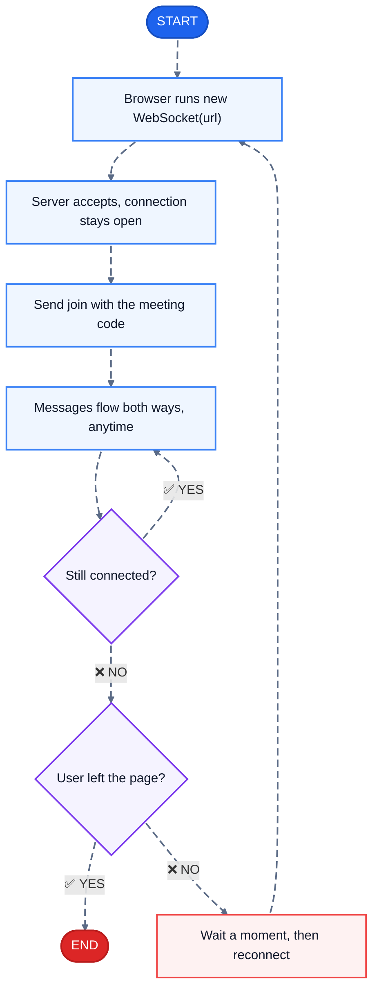
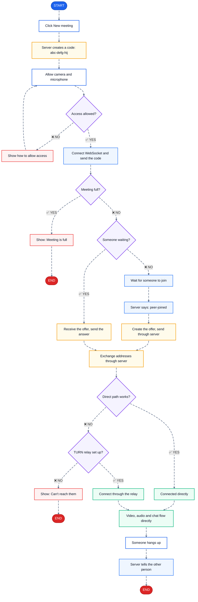

<div align="center">

# 🎙️Vedha AI Interview Platform

**Proctored video interviews with per-question recording and voice-to-text answers.**


<a href="https://buymeacoffee.com/vishalkardan1508" target="_blank">
  
</a>

</div>

---

## Quick Start

```bash
npm install
npm run dev       # → http://localhost:3000
```

To change port:
```bash
npm run dev -- -p 4000
```
Or edit `package.json` → `"dev": "next dev -p 4000"`

---

## What's New in v2

### 1. Per-question recording
Each question gets its own separate video + audio file. Clicking "Next Question" stops the current recording and starts a new one. Final results show all 5 recordings independently.

### 2. Voice-to-text answer input
No typing needed. The answer box is **read-only** — it fills automatically from the Web Speech API as you speak. Live "Listening…" indicator shows recognition is active. Restarts automatically if it stops.

### 3. Voice warnings (system audio)
When a tab change or window blur is detected, the browser speaks the warning aloud via `SpeechSynthesis` — you hear *"Warning. Tab switching is not allowed during the interview."*

### 4. Video + Audio modal playback
On the results screen, each question has:
- **Watch Video** → modal with `<video>` player (screen + webcam PIP + all audio)
- **Listen Audio** → modal with `<audio>` player (merged mic + system audio)
- Download buttons for each

---

## Recording Architecture

```
Screen share (getDisplayMedia)
  └─ video track → Canvas composite
  └─ audio track → AudioContext merge

Webcam (getUserMedia video)
  └─ video track → Canvas PIP overlay

Mic (getUserMedia audio)
  └─ audio track → AudioContext merge

AudioContext
  └─ mic + system audio → MediaStreamDestination

Canvas (1280×720)
  └─ screen video (full)
  └─ webcam PIP (bottom-right, 280×210)
  └─ REC indicator

Final MediaRecorder stream:
  └─ canvas.captureStream(30fps) [video]
  └─ AudioContext destination [audio]
```

Per question:
- `MediaRecorder` → `.webm` video (screen+cam+all audio)
- Second `MediaRecorder` → `.webm` audio only

---

## Project Structure

```
src/
├── app/
│   ├── page.tsx              # Orchestrator — all step state
│   ├── layout.tsx            # Root layout
│   └── globals.css           # Full design system
│
├── components/
│   ├── LandingStep.tsx
│   ├── PermissionsStep.tsx   # Requests screen, webcam, mic in sequence
│   ├── InterviewStep.tsx     # Question UI + voice transcript + per-Q recording
│   ├── ProcessingStep.tsx    # Processing animation
│   ├── SubmittedStep.tsx     # Results with per-question cards
│   ├── MediaModal.tsx        # Video/audio playback modal
│   └── WarningModal.tsx      # Top toast warning
│
├── hooks/
│   ├── useQuestionRecorder.ts  # Per-question canvas+audio recording + speech recognition
│   ├── useProctoring.ts        # Tab/blur detection + SpeechSynthesis voice warnings
│   └── useTimer.ts
│
├── lib/
│   ├── constants.ts
│   └── utils.ts
│
└── types/index.ts
```

---

## Browser Requirements

| Feature | Chrome | Edge | Firefox | Safari |
|---|---|---|---|---|
| Screen capture | ✅ | ✅ | ✅ | ✅ |
| System audio | ✅ | ✅ | ❌ | ❌ |
| Speech recognition | ✅ | ✅ | ❌ | partial |
| MediaRecorder | ✅ | ✅ | ✅ | ✅ |

**Use Chrome for the best experience.**

---

## Permissions Flow

1. `getDisplayMedia({ video, audio: true })` — screen + system audio (user picks entire screen)
2. `getUserMedia({ video: true })` — webcam only
3. `getUserMedia({ audio: true })` — microphone only

---

<h1 align="center">📞 Duo Meet</h1>
<p align="center"><b>Call Workflow</b></p>

<p align="center">
🟦 WebSocket &nbsp;·&nbsp; 🟨 Through the server &nbsp;·&nbsp; 🟩 Direct, browser to browser &nbsp;·&nbsp; 🟪 Decision &nbsp;·&nbsp; 🟥 Problem shown to the user
</p>

---

## 1. WebSocket connection

How each browser stays connected to the server.



---

## 2. Meeting call

From creating a meeting to hanging up, for either person.



---

> [!IMPORTANT]
> 🚫 **Video never goes through the WebSocket or the server.** Only the setup messages do.

## 👨‍💻 Creator

**Vishal Kardam**, creator and developer of AI Interview Platform.

- GitHub: [@vishalkardam1508](https://github.com/vishalkardam1508)

If this project helps you, consider supporting it:

<a href="https://buymeacoffee.com/vishalkardan1508" target="_blank">
  
</a>
